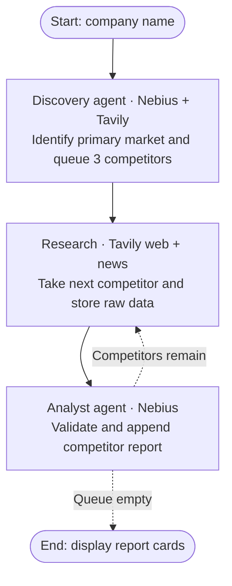

# Market Research Agent

A Streamlit app that accepts a product or service company name and displays three competitor report cards.

## Run locally

Requires Python 3.10 or later.

```bash
python3 -m venv .venv
source .venv/bin/activate
pip install -r requirements.txt
streamlit run app.py
```

Create a `.env` file beside `app.py` and set `NEBIUS_API_KEY` and `TAVILY_API_KEY` there. API keys are read only from this file and are never displayed or requested in Streamlit. `NEBIUS_MODEL` defaults to `Qwen/Qwen3.5-397B-A17B` and can be configured in `.env` or changed in the sidebar to another Nebius model supporting tool calls. Never commit API keys.

## Workflow

Nebius configuration in `.env`:

```dotenv
NEBIUS_API_KEY=your_nebius_token_factory_key
NEBIUS_MODEL=Qwen/Qwen3.5-397B-A17B
NEBIUS_BASE_URL=https://api.tokenfactory.nebius.com/v1/
TAVILY_API_KEY=your_tavily_key
```

Select a model with tool-calling support that your Nebius account can access.
The endpoint is configured explicitly following the [Nebius LangChain cookbook](https://dev.nebius.com/cookbook/short-term-memory-langchain).
Existing `GROQ_*` settings are no longer read. Restart Streamlit after changing providers.

The workflow has three stages. Discovery and analysis use LangChain `create_agent` with `ChatNebius`; research fetches Tavily results directly without an agent or model:

1. **Discovery:** Tavily web evidence identifies the primary market and exactly three distinct competitors. `ToolStrategy(DiscoveryResult)` validates structured output. Selection is by market/product fit, not a verified market-share ranking.
2. **Research:** One Tavily web search and one Tavily news search run for every competitor. Their normalized results are passed directly to analysis, with no LLM call.
3. **Analyst:** Receives the raw research dictionary and returns a Pydantic `CompetitorReport` through `ToolStrategy`. It has no search tools and is instructed to extract only supported facts.



The diagram follows the graph in `pipeline.py`. Failed research skips analysis
for that competitor; failed analysis records an error. In either case, the
workflow continues with the remaining queue and retains successful reports.

The workflow uses a shared `ResearchState` TypedDict in `models.py`, passed as
`state_schema=ResearchState` to both agents and used by the direct research step and orchestration
`StateGraph`. It extends LangChain's `AgentState` to retain the required message
channels and adds:

```python
company: str
competitor_queue: List[str]
current_target: str
raw_data: str
final_reports: Annotated[List[dict], operator.add]
```

Discovery fills the queue. Research consumes one name at a time and serializes
its captured `ResearchBundle` into `raw_data` as JSON. Analysis reads that JSON
and returns only the new report, which the graph reducer appends to
`final_reports`. The graph loops until the queue is empty. Raw data is cleared
before each competitor, and each submitted run starts with fresh state.
Discovery metadata, source bundles for inspection, and errors remain local to
the run and are combined with `final_reports` for the Streamlit report cards.

Every normalized search result has exactly `title`, `url`, `content`, and `published_date`. Missing publication dates remain `null`. Content is the text returned by Tavily, which may be excerpts rather than full pages.

Each report card contains:

- `competitor_name`
- `pricing_model`: revenue model and specific prices when available
- `core_features`: 3–5 entries; missing evidence is explicitly labeled
- `market_positioning`: target customers, segment, and differentiation
- `recent_news`: dated launches or news, with title, summary, URL, and publication date
- `source_urls`: links to the captured supporting evidence

News defaults to a 30-day window, configurable to 7 or 90 days. Undated, stale, and future-dated news is excluded. The app shows raw research, provides JSON download, and preserves successful competitor cards if another competitor fails. Results persist across Streamlit reruns in the current session. Each submitted run makes paid/quota-limited provider calls; it is not globally cached.

Source URLs and dates are checked against captured evidence. This does not independently verify every generated claim; review linked sources for important decisions. Unknown pricing is reported as missing.

## Tests

```bash
pip install -r requirements-dev.txt
python -m pytest -q
```

Tests use fake providers and Streamlit's app testing API, so no API keys or paid requests are required. Real provider behavior requires a live run with valid credentials.

API references: [LangChain structured output](https://docs.langchain.com/oss/python/langchain/structured-output), [ChatNebius](https://github.com/nebius/langchain-nebius), and [Tavily Python SDK](https://docs.tavily.com/sdk/python/reference).
